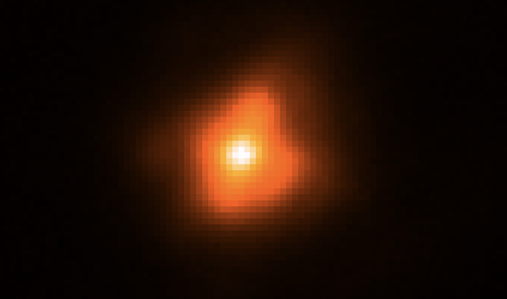

# Shane-AO-Reduction

A Python pipeline for reducing adaptive optics (AO) images taken with the ShARCS camera on the 3 m Shane Telescope at Lick Observatory.

It is built for high-contrast imaging, and works best with the 5-point dither sequence described in [Furlan et al. 2017](https://ui.adsabs.harvard.edu/abs/2017AJ....153...71F/abstract).



## Pipeline

Starting from a night of raw FITS frames, the pipeline:

1. **Sorts frames** into science targets, flats, and darks using their FITS headers, and drops vetoed frames.
2. **Dark-corrects** every science and flat frame using a master dark for each exposure time.
3. **Flat-fields** the science frames using a normalized master flat for the target's filter.
4. **Removes bad pixels** by replacing outliers with the median of their neighbors.
5. **Subtracts the sky** using a median master sky built from the dither positions.
6. **Aligns and stacks** the frames by cross-correlation against the highest signal-to-noise frame, then median-combines them into a final image.

## Installation

Requires Python 3.9 or newer.

```bash
git clone https://github.com/CCBeard/Shane-AO-Reduction.git
cd Shane-AO-Reduction
pip install -e ".[notebooks]"
```

## Usage

The workflow runs in two Jupyter notebooks, both configured by default to use the sample night of data in `Raw_Data/Test_Data/`.

1. **`Veto.ipynb`** scans a night of data and writes `veto_list.txt`, which lists frames to reject. By default it rejects frames that are overexposed (more than 25,000 counts at the star's centroid) or underexposed (fewer than 500 counts). Adjust these thresholds to suit your science case.
2. **`Image_Reduction_Plots.ipynb`** runs the full reduction for one target, showing diagnostic plots at each step, and writes the final stacked image to `Results/` as FITS and PNG.

To reduce your own data, put a night of observations in its own folder under `Raw_Data/` and set `datadir` at the top of each notebook to that folder.

The reduction functions can also be imported directly:

```python
from shane_ao.dark_correct import generate_master_darks, dark_correct
from shane_ao.flat_field import make_master_flats, flat_field
from shane_ao.sky_subtraction import make_master_sky, sky_subtract
from shane_ao.utils import sigma_clip, image_shift
```

## Repository layout

```
├── src/shane_ao/              # Reduction library
│   ├── dark_correct.py        # Master darks and dark subtraction
│   ├── flat_field.py          # Master flats and flat-fielding
│   ├── sky_subtraction.py     # Dither-based master sky and sky subtraction
│   └── utils.py               # Bad-pixel removal, centroiding, alignment, plotting
├── Veto.ipynb                 # Automatic frame rejection
├── Image_Reduction_Plots.ipynb  # End-to-end reduction walkthrough
├── Raw_Data/Test_Data/        # Sample night of ShARCS data
└── Results/                   # Example reduced output
```

## Contributing

Notebook outputs are stripped before committing to keep diffs small. To set this up locally:

```bash
pip install pre-commit
pre-commit install
```

## Acknowledgments

Thanks to [@TeHanHunter](https://github.com/TeHanHunter) for improvements to centroid selection and dither-position handling for laser guide star (LGS) data.

## License

Released under the [MIT License](LICENSE).
